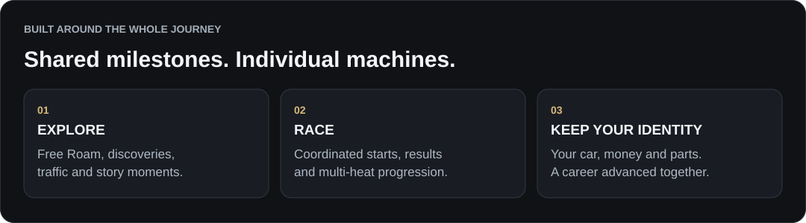
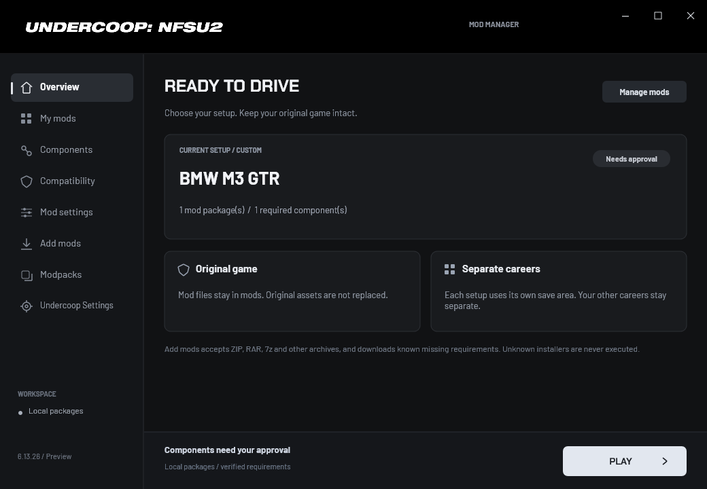
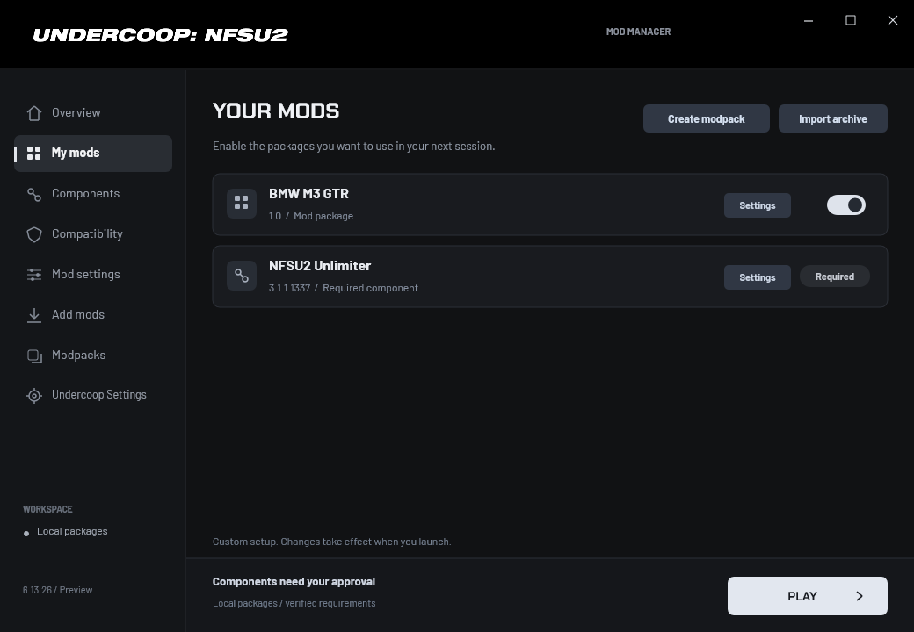
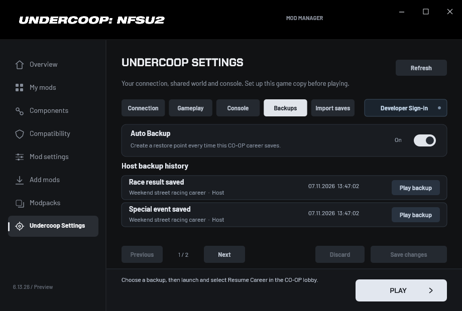
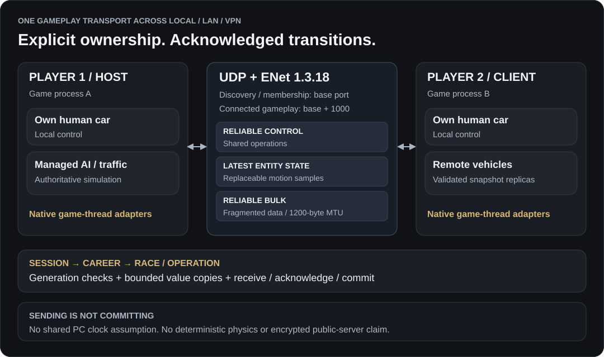

<p align="center">
  
</p>

<p align="center">
  <strong>Two drivers. One career. Bayview, together.</strong><br>
  A two-player co-op career mod and integrated mod manager for Need for Speed: Underground 2.
</p>

<p align="center">
  
  
  
  
</p>

<p align="center">
  <a href="https://discord.gg/Hcuf5px27E"></a>
  <a href="https://www.patreon.com/c/undercoop"></a>
  <a href="https://undercoop.dev/"></a>
  <a href="https://developer.undercoop.dev/status"></a>
</p>

> **Open Beta · 6.13.33**
>
> Undercoop is in active development. The systems below are implemented, but unusual race transitions, mod combinations and remote sessions can still expose bugs. Keep your own save copies, use the same Undercoop build on both PCs, and report problems with both players' logs. This repository contains the mod and launcher source, not the original game.

<p align="center">
  
</p>

**Made by batuhan.** Undercoop brings a shared campaign to a game built around a single local player: career decisions, race transitions, AI, traffic, discoveries, cutscenes and save handling each need explicit co-op integration. Its native launcher also provides a place to manage mods, dependencies, settings and careers before the game starts.

**Explore the project:** [Co-op features](#co-op-features) · [Mod manager](#the-integrated-mod-manager) · [VirusTotal / antivirus](#virustotal-and-antivirus-alerts) · [Getting started](#getting-started) · [Network architecture](#network-architecture) · [Build from source](#build-from-source) · [Bug reports](#reporting-a-problem) · [Licensing](#licensing-and-branding)

### Latest patch · 6.13.33

- Select **Deactivate** on the active modpack to restore your previous custom setup and its careers.
- Temporary INI writer locks are retried before the lobby's mod verification reports a failure. This fixes the observed false failure with the bundled ReShade configuration.

Compatible ASI loader builds are now accepted by their required virtual-file APIs, instead of being rejected for differing from one preview build's SHA-256. Missing or outdated loader features produce an actionable installation message.

See [the patch notes](docs/PATCH_6.13.33.md) and [underground2.net import instructions](docs/PATCH_6.13.32.md).

## Co-op features

| System | How it works |
| --- | --- |
| **Shared career** | Campaign progress and genuine discoveries are synchronized. Each player keeps their own cars, money, garage and modifications. Undiscovered hidden races are not globally revealed. |
| **Free Roam** | Explore Bayview together, with synchronized managed traffic and ambient racers. Teammates have green map styling and distance-scaled 2D name labels with wall-occlusion checks. |
| **Race entry** | Invitations and consent coordinate the transition. Vehicle readiness, loading/grid preparation and the actual race countdown have separate synchronization stages. |
| **Race results** | Shared resolution waits for both human terminal results. A player finishing early does not immediately decide the team's outcome. Restart and leave requests have their own shared agreement. |
| **Cutscenes** | Story/tutorial movies use a shared lifecycle and vote-to-skip flow, including transitions around races and shops. |
| **Sponsors** | The Host proposes a sponsor. Player 2 approves or declines. An agreed choice is committed and applied on both sides. |
| **Visual-star progression** | Both players must meet the relevant requirement with their current cars before shared progression advances. Their actual star ratings and modifications remain individual. |
| **Special Events** | Photo opportunities, magazine/DVD cover flows, timed destination drives and unique-part events have dedicated co-op handling. Both players must be inside the real starting area. For timed drives, both must arrive; one timeout fails the team. |
| **Local menus** | Ordinary pause menus are local. They do not pause the shared world or stop AI for the other driver. Restart/leave consent and movie-skip voting remain separate actions. |
| **Chat and console** | Player chat and system notices have separate channels. Invitations use dedicated accept/decline keys instead of competing with native Enter/Escape actions. |
| **Connection HUD** | A small persistent indicator shows live measured ping, connection state and the teammate's current activity. Quality is green/orange/red; stale activity is unavailable and an unmeasured or interrupted link is not displayed as healthy zero-millisecond ping. |

### Race-mode integration

| Mode | Co-op result handling |
| --- | --- |
| **Circuit / Sprint / Street X** | Shared entry, managed AI, both-player finish resolution, results and restart/return transitions. |
| **Drift** | Actual human drift scores and sealed AI results are synchronized. The later finisher's higher score is included before the team result is resolved. |
| **Drag** | Time-based results distinguish valid finishes from unset/zero times and terminal failures such as totaled/engine blown. Two human DNFs cannot become a team victory through display rank. |
| **U.R.L.** | A dedicated multi-heat ledger tracks stable driver identities, acknowledged round results and next-heat commits. The best human driver's **actual overall tournament total** determines the team's result; human scores are not added together. |
| **Outrun** | Dedicated Host-authoritative opponent/scoring integration and shared outcomes. Modified AI systems still need real gameplay testing during Open Beta. |

## The integrated mod manager

<p align="center">
  
</p>

The launcher is hosted by `NFSU2Coop.asi` and opens when the game starts through a compatible ASI loader. A separate Undercoop launcher executable is not required. Supported mod resources are composed below `mods`, with the original game assets used as a fallback.

| Area | Capabilities |
| --- | --- |
| **My mods** | Import and review archives or game-ready folders, enable/disable registered mods and inspect their requirements. Folder manifests are generated by the launcher; unregistered folders do not block the rest of the library. |
| **Mod settings** | Discover supported INI files and group them under their owning mod instead of mixing unrelated files. |
| **Dependencies** | Resolve known component recipes, request approval for downloads and verify downloaded content. Extra Options, Unlimiter and the optional Binary runtime have dedicated support. |
| **Compatibility** | Compare the effective installed files/settings using relative paths, sizes and SHA-256 inventories. Matching sessions normally exchange compact digests; differences produce a bounded inventory report. |
| **Modpacks / instances** | Create a named snapshot of the library, including disabled packages, exact versions/settings, installation receipts and the current careers. Activate a complete setup or edit its independent revisions. |
| **Undercoop Settings** | Configure the player's role, peer IPv4/ports, synchronized AI/traffic, console appearance, automatic backups and save imports. |

<p align="center">
  
</p>

*Screenshots show the public-font launcher. Example package names and careers illustrate the interface; third-party mods and their game assets are not bundled here.*

### Archive and installer support

Reading an archive and understanding its installer are separate jobs.

| Input | Current support |
| --- | --- |
| **ZIP/ZIP64, RAR4/RAR5, 7z, TAR and supported compressed wrappers** | Bounded archive inspection/extraction through the bundled decoder. Password-protected/split archives, self-extracting executables and unsafe special entries are rejected. |
| **Manual resource layouts** | Recognized game-resource trees such as `CARS`, `GLOBAL`, `FRONTEND`, `LANGUAGES`, `TRACKS`, `MOVIES`, `SOUND` and `scripts`. |
| **ASI + INI packages** | Recognized scripts-style native-plugin layouts, with separate native-code approval at launch. |
| **Prepared Undercoop packages** | Explicit package mappings, identities and dependency metadata. |
| **Binary data installations** | Supported Underground2 User-mode `VERSN1` launchers and `VERSN2` data scripts, including recognized standalone data scripts and hybrid resource/data archives. Compatible launcher choices are presented when needed. |
| **Legacy tool-specific formats** | `.u2car` / `.u2cfg`, VltEd `.nfsms` and TexMod `.tpf` require additional adapters and are not currently universal one-click imports. |
| **Executable installers** | Archive-supplied EXE/MSI/batch/PowerShell/registry installers are not executed automatically. Unknown Binary operations require implementation rather than arbitrary script execution. |

The Binary worker uses source-built **Nikki** and **CoreExtensions**, with bounded data/compression adapters. If it needs **.NET 8 x86**, the launcher offers an approved, verified private runtime under `mods/_undercoop/runtimes`; it does not run a global system installer. Normal co-op gameplay does not itself require the Binary worker's .NET runtime.

**A matching mod inventory is not a universal compatibility certificate.** Native plugins run inside the game process and are not sandboxed; they can alter physics, memory or original files outside the manager's resource model. Both players need matching effective setups, and each new combination needs a real co-op test.

## Careers, backups and imported saves

<p align="center">
  
</p>

- **Stable career bindings:** ordinary mod/INI edits and instance revisions do not use a changing compatibility digest as the save identity. Named setups maintain their own career bindings.
- **Auto Backup:** enabled in the supplied INI, it records restorable snapshots after successful CO-OP saves. The launcher lists dated entries and the action that created them.
- **Paired recovery:** a Host-selected restore is coordinated with a compatible backup of Player 2's own career. Missing matching data is refused instead of overwriting Player 2's possessions with the Host's.
- **Save import:** import a local singleplayer profile or an external native save before play. The launcher validates the native format, CRC and internal identity and prepares the appropriate CO-OP role forms. **Both players must import the same original save and use matching setups.**
- **Resume:** the last successfully loaded career is remembered. The INI's `Profile` value is an initial Host preference, not a command to keep replacing the active career.

Backups reduce recovery risk; keep an external copy before experimenting with unfamiliar mods or save conversions.

## VirusTotal and antivirus alerts

**Maintainer assessment: the reported detections on the reviewed 6.13.28 binary are likely false positives.** This assessment is based on a focused source review and verification of its embedded mod-installation helper. The detecting vendors have not confirmed this assessment.

**[View the VirusTotal report for the reviewed ASI](https://www.virustotal.com/gui/file/2ab74b2d32ea4fdffe29834dd022a3d8537df3bc7883f8f6ee7f016dfbec1de9/detection)**

The report supplied for review showed two detections: SecureAge **`Malicious`** and Skyhigh (SWG) **`BehavesLike.Win32.Dropper.vm`**. Its **Relations** view also showed two detections for the embedded `Undercoop.Binary.dll`. Detection counts can change after rescanning.

### Why a mod manager can resemble a dropper

Undercoop installs hooks inside the running game and changes code-page permissions to integrate co-op with the original engine. Its launcher also extracts bundled helper libraries and starts the Binary data-conversion worker through the .NET runtime. The reviewed ASI is unsigned. These are plausible heuristic triggers; the antivirus vendors have not disclosed which rules matched this file.

`Undercoop.Binary.dll` prepares supported Binary-based mod data inside a bounded `job-*` workspace. Our focused review found no networking, child-process launch, startup persistence or antivirus-disabling calls in that worker's own source. Unsupported installer operations are rejected. The embedded worker was verified byte-for-byte against the locally built helper:

| Reviewed artifact | SHA-256 |
| --- | --- |
| `NFSU2Coop.asi` — 6.13.28 sample | `2ab74b2d32ea4fdffe29834dd022a3d8537df3bc7883f8f6ee7f016dfbec1de9` |
| Embedded `Undercoop.Binary.dll` | `33aa6615168d5b5bca38d1cabb7d4c1ad35c2c8856e4566b1842454929a3e303` |

The helper is intentionally compiled as an x86 .NET application named `.dll`, so VirusTotal's **Win32 EXE** classification is consistent with its build configuration. Framework-dependent .NET applications can run through `dotnet application.dll`. See [the worker source](src/binary_engine/Program.cs), [its build script](scratch/BuildBinaryEngine61216.ps1), [the launcher adapter](src/CoopBinaryEngineWin.inl) and [Microsoft's documentation](https://learn.microsoft.com/en-us/dotnet/core/tools/dotnet).

VirusTotal's **PE Resource Children** list identifies files embedded as resources. That relationship alone does not establish execution or malicious behavior. See [VirusTotal's definition](https://docs.virustotal.com/reference/file-object-pe-resource-children).

### What this review establishes

The reviewed worker code paths are consistent with an offline game-data converter. The low detection count and clean results for other components support further investigation; they do not establish safety on their own. This was a focused static review, with no complete sandbox behavior report or independent vendor clearance. Third-party native mods still require their own review.

This report applies to the exact ASI hash above. Other releases and local builds, including builds using this repository's public-font assets, need their own scan. You can check your file with:

```powershell
Get-FileHash .\scripts\NFSU2Coop.asi -Algorithm SHA256
```

If an antivirus flags your copy, include its detection name, the file hash and the report link in a [GitHub issue](https://github.com/Undercoop/Undercoop-NFSU2/issues). We support submitting suspected false positives to the detecting vendors for review; do not disable protection to resolve an alert. [VirusTotal explains that review process here](https://docs.virustotal.com/docs/false-positive).

## Getting started

### Requirements

1. A legally obtained Windows copy of **Need for Speed: Underground 2**, using the supported **v1.2 NTSC** executable. The current native integration targets `SPEED2.EXE` of **4,800,512 bytes**; other executable revisions are not automatically supported.
2. **Ultimate ASI Loader x86**, installed as `dinput8.dll` beside `SPEED2.EXE`, with the virtual-path APIs listed below. Undercoop checks the active loader's location and required features; it does not require one exact preview build. The loader is a separate prerequisite and is not included in this source repository; its upstream project is [Ultimate ASI Loader](https://github.com/ThirteenAG/Ultimate-ASI-Loader).
3. The same Undercoop version and matching effective game/mod files on both players' computers.
4. A reachable IPv4 connection over the same PC, LAN or a trusted virtual LAN such as Radmin VPN. This build does not provide public matchmaking, a relay service or a dedicated server.

This repository is a source distribution. Build the ASI using the instructions below, or use a matching ready-to-run release if one has been published under [Releases](https://github.com/Undercoop/Undercoop-NFSU2/releases). Game files, third-party mod packs and a working game installation must be supplied separately.

<details>
<summary><strong>ASI loader compatibility</strong></summary>

The active game-root `dinput8.dll` must provide `IsUltimateASILoader`, `AddVirtualPathForOverloadW` and `RemoveVirtualPathFromOverloadW`, using Ultimate ASI Loader's x86 calling conventions. Its identity marker must return true. Older loaders without these virtual-file features cannot provide the mod overlay; update the loader and restart if prompted. Other proxy filenames are not supported by this integration.

The file remains locked while the setup is active. The launcher never replaces the loader or starts another loader executable. The compatibility check is implemented in [CoopManagerLoader.inl](src/CoopManagerLoader.inl).

Both teammates must still use matching effective files, including the loader. This patch removes the single-build launcher restriction; it does not disable the lobby's installed-file comparison.

</details>

### Install and connect

1. Keep a backup of your game and saves. Put the built `NFSU2Coop.asi` and supplied `scripts/NFSU2Coop.ini` in the game's `scripts` directory, alongside the compatible loader setup.
2. Start `SPEED2.EXE`. Undercoop automatically creates missing startup files and the `mods/_undercoop/state` workspace. In the integrated launcher, configure **Undercoop Settings → Connection**. Use explicit Host/Player 2 roles for a two-computer setup.
3. Put each teammate's LAN/VPN **IPv4 address** in the other copy's peer setting. Use matching reciprocal ports. For two local game copies, use `127.0.0.1` and separate game directories.
4. Select matching mods and gameplay options. Start the game, open CO-OP, host/join the lobby and let the compatibility/readiness checks finish.
5. The Host opens **Start the Career** and chooses or creates the shared career. For imported careers, prepare the same original save on both computers first.

<details>
<summary><strong>Connection example and firewall ports</strong></summary>

Example values below use the supplied source snapshot's port pair, **48930 / 48931**. Replace the example peer addresses with your teammate's real LAN/VPN IPv4.

| Setting | Player 1 / Host | Player 2 / Client |
| --- | --- | --- |
| `Instance` | `1` | `2` |
| `PeerAddress` | Player 2's IPv4 | Player 1's IPv4 |
| `Port` | `48930` | `48931` |
| `PeerPort` | `48931` | `48930` |
| Local connected-gameplay port | `49930/UDP` | `49931/UDP` |

Allow both the configured **base UDP port and base + 1000** through the relevant firewall. Discovery/membership and connected gameplay use different sockets. A visible lobby alone does not prove that the gameplay socket is ready.

The supplied generic INI uses `Instance=0` (automatic), loopback IPv4 and an empty `Profile`. Adjust roles/addresses for your actual setup. DNS names and IPv6 are not supported by this configuration path.

</details>

### Controls

| Key | Action |
| --- | --- |
| **Z** | Open/close the co-op console. |
| **Enter**, console open | Compose a message; Enter again sends it. |
| **Tab**, console open | Switch Chat / System channel. |
| **Esc**, console open | Cancel composition or close the console. |
| **Page Up / Page Down** | Scroll console history. |
| **F5 / F6** | Accept / decline shared invitations and proposals. |
| **F9** | Toggle teammate-car synchronization for diagnostics. |
| **F10** | Toggle the debug overlay. |

## Network architecture

<p align="center">
  
</p>

Undercoop uses **ENet 1.3.18 over UDP** for connected gameplay. Raw UDP remains for discovery and membership controls. Local, LAN and VPN sessions use the same connected gameplay adapter; latency, loss, machine speed and mod behavior can still produce different runtime conditions.

| Delivery class | Purpose |
| --- | --- |
| **Reliable control** | Ordered operations such as career/race/movie decisions and shared transitions. |
| **Replaceable per-entity state** | Current vehicle motion; newer state supersedes old samples rather than creating an ever-growing reliable movement backlog. |
| **Reliable bulk** | Larger data transfers, including vehicle/setup information. ENet fragmentation uses a configured **1200-byte MTU**. |

### Ownership and replication

- **Each human drives locally.** The remote human car is reconstructed from validated snapshots, using buffered interpolation and bounded extrapolation.
- **The Host owns managed AI/traffic simulation.** The Client applies replicas rather than independently deciding those shared actors' behavior.
- **Contacts reference observed state.** Client contact requests identify the Host snapshot that was actually observed, instead of treating unrelated PC clocks as a common timestamp.
- **Native work stays on the game thread.** Network ingress carries bounded value copies. Native object pointers are not treated as transferable remote identities.

### Transitions are protocols, not single messages

A successful send means a message entered a local queue. It does not prove that the teammate received it, accepted it or applied its result.

Session/membership/connection generations, career tickets and race tokens reject stale work after a reconnect, career change or restart. Shared systems have their own receive/acknowledge/commit rules. A local car cache cannot stand in for the teammate's current vehicle readiness. Race loading, a prepared grid and the HUD countdown are separate barriers.

The transport is intended for **trusted two-player LAN/VPN sessions**. It does not supply cryptographic peer authentication, encrypted public-server networking or deterministic lockstep physics. Radmin provides a network path; it does not replace Undercoop's game-state protocols.

### Runtime technologies

| Layer | Implementation |
| --- | --- |
| Native game integration | **C++17**, Windows x86, MSVC, verified native hooks and game-thread adapters. |
| Transport | **ENet / Winsock UDP**, bounded queues and application-level operation identities. |
| Launcher and overlays | **Win32, Direct2D, DirectWrite, WIC and GDI+**; private embedded fonts and native controls. |
| Archives | Separate bundled **7-Zip** decoder and **miniz**, with inspection/extraction budgets. |
| Binary conversion | C# data worker, source-built **Nikki / CoreExtensions**, optional private **.NET 8 x86** runtime. |
| Compatibility | Relative-path file inventories, SHA-256 digests, installed-catalog and native-loader readiness checks. |
| Persistence | Native profile validation, role-aware save handling, stable career domains, snapshots and restore coordination. |
| Online notices | Bounded HTTPS polling of public status endpoints, severity/read acknowledgements, Play gating and offline warnings. The management service is outside this repository. |
| Optional online service | The separate management service uses **Firebase Authentication / Firestore** and **Vercel** hosting. Its implementation and private configuration are excluded from this mod/launcher source release. |
| Discord Rich Presence | Local Discord IPC and a fetched public application identity. No Discord webhook credential is required in the ASI. |
| Diagnostics | Normal/network logs, scoped state/input/result traces and a custom unhandled-exception crash dialog. |

## Build from source

### Main ASI

Install **Visual Studio C++ desktop tools** and a **Windows SDK**, including the x86 toolchain. Then run:

```bat
Build-Source.cmd
```

The script locates Visual Studio through `vswhere`, selects x86 and builds ENet, the transport adapter, resources and the launcher-enabled mod.

```text
output/NFSU2Coop.asi
```

Python, Node.js, Firebase credentials and the private developer website are not required to build this ASI from the supplied snapshot.

### Embedded data libraries

The source snapshot includes the required decoder/data-library binaries together with their corresponding sources and notices.

- **Binary worker / Nikki / CoreExtensions:** use `scratch/BuildBinaryEngine61216.ps1` after adjusting its compiler and .NET reference paths to the build machine. The old upstream Nikki solution is not the Undercoop build entry point.
- **7-Zip decoder:** complete modified source is in `research/undercoop-7zip2605-src.tar.xz`. Rebuild/replacement instructions and the allocation-budget changes are documented in [ArchiveEngineSource.txt](src/assets/ArchiveEngineSource.txt).
- **Public UI assets:** Barlow and Chakra Petch are bundled under SIL OFL 1.1, with provenance and license files. The public startup splash uses the Undercoop logo.

### Source map

| Area | Entry points |
| --- | --- |
| Game integration | [`NFSU2Coop.cpp`](src/NFSU2Coop.cpp), native `*.inl` adapters. |
| Network/session | [`CoopTransport.h`](src/CoopTransport.h), [`CoopTransportEnet.inl`](src/CoopTransportEnet.inl), [`CoopSession.h`](src/CoopSession.h), [`CoopNetworkPolicy.h`](src/CoopNetworkPolicy.h). |
| Vehicles and shared world | [`CoopMotion.h`](src/CoopMotion.h), [`CoopWorldSync.h`](src/CoopWorldSync.h), [`CoopWorldImpact.h`](src/CoopWorldImpact.h). |
| Race lifecycle/results | [`CoopRaceLifecycle.h`](src/CoopRaceLifecycle.h), [`CoopRaceFinish.inl`](src/CoopRaceFinish.inl), [`CoopUrlTournament.h`](src/CoopUrlTournament.h). |
| Career decisions | [`CoopSponsor.h`](src/CoopSponsor.h), [`CoopVisualGate.h`](src/CoopVisualGate.h), [`CoopSpecialDriver.inl`](src/CoopSpecialDriver.inl). |
| Mod manager | [`CoopModManagerWin.h`](src/CoopModManagerWin.h), [`CoopManagerImport.inl`](src/CoopManagerImport.inl), [`CoopBinaryEngineWin.inl`](src/CoopBinaryEngineWin.inl). |
| Saves and recovery | [`CoopCareerBackupWin.h`](src/CoopCareerBackupWin.h), [`CoopCareerRestoreWin.h`](src/CoopCareerRestoreWin.h), [`CoopManagerCareerImport.inl`](src/CoopManagerCareerImport.inl). |
| Dependencies | `src/third_party`, `src/binary_engine`, `research/nikki-binary-audit`, `research/coreextensions-binary-audit`. |

### Verification scope

This public snapshot has passed a clean **x86 source build**, finalized-part visibility regressions, real ENet loopback RTT/reconnect tests, and connection-HUD state/color/DPI tests. Run the patch's included checks after building:

```bat
tests\Run-Tests.cmd
```

The source also includes standalone session, profile and checkpoint tests under `src`. Broader development fixtures are not all part of this export.

Automated protocol tests and native-memory fixtures are useful evidence; they do not replace two-computer gameplay validation. Test local and real remote sessions, including both finish orders, DNFs, results-screen restarts, career switches, reconnects, sponsor choices and timed Special Events. A custom crash dialog cannot handle every OS termination or catastrophic process failure.

## Reporting a problem

Use [GitHub Issues](https://github.com/Undercoop/Undercoop-NFSU2/issues) or [Discord](https://discord.gg/Hcuf5px27E). Include:

1. Undercoop version, game executable revision and the active mod setup.
2. Local/LAN/VPN connection, which player was Host, and exactly what each screen showed.
3. The race/event/shop and a short reproduction sequence, including who finished or accepted first.
4. **Both players' logs**, captured before restarting the game:

```text
scripts/NFSU2Coop.log             or NFSU2Coop_2.log
scripts/NFSU2Coop-Network-P1.log  or NFSU2Coop-Network-P2.log
scripts/NFSU2Coop-Mods.txt
```

The normal log is recreated at startup. Review attachments for personal paths, IPs or other information before posting publicly. Share saves only when needed, and keep an untouched copy.

For current notices, check **[Undercoop Status](https://developer.undercoop.dev/status)**. The launcher also receives live notices, presents severity-based acknowledgements and warns when offline status cannot be checked. Developer administration and private service credentials are not part of this source release.

## Licensing and branding

**Copyright © 2026 batuhan.** Original Undercoop code is licensed under **GNU GPL version 3 only**, with the narrow additional permission for the distributed 7-Zip decoder.

| Document | Scope |
| --- | --- |
| [LICENSE / GPLv3](LICENSE) and [COPYING](COPYING) | Full GPLv3 text. |
| [LICENSE.md](LICENSE.md) | Original-code license scope. |
| [LICENSE-7ZIP-EXCEPTION.txt](LICENSE-7ZIP-EXCEPTION.txt) | Approved, limited permission for the separately loaded 7-Zip decoder combination. |
| [THIRD_PARTY_NOTICES.md](THIRD_PARTY_NOTICES.md) | Component copyrights and retained MIT, LGPL/BSD/unRAR and SIL OFL terms. |
| [TRADEMARKS.md](TRADEMARKS.md) | Separate Undercoop name/logo policy. |

GPLv3 allows use, modification and redistribution, including commercial distribution, subject to its obligations. **Undercoop branding is reserved separately**: independently maintained products must not imply official affiliation or endorsement. Truthful attribution and uses permitted by applicable trademark law remain permitted. The brand policy does not remove GPL code rights or establish a trademark registration.

ENet, miniz, Nikki and CoreExtensions retain their MIT notices. The 7-Zip decoder retains its applicable LGPL/BSD/unRAR terms. Barlow and Chakra Petch retain SIL OFL 1.1. The developer website/backend, original game files and third-party mod assets are outside this source release.

Undercoop is an independent community project. Need for Speed, Underground 2 and other third-party names/marks belong to their respective owners; this project is not an official EA release.

---

<p align="center">
  <strong>Made by batuhan</strong><br>
  <a href="https://undercoop.dev/">Website</a> ·
  <a href="https://discord.gg/Hcuf5px27E">Discord</a> ·
  <a href="https://www.patreon.com/c/undercoop">Patreon</a> ·
  <a href="https://developer.undercoop.dev/status">Undercoop Status</a><br>
  <sub>NFSMods.xyz listing: coming later. No listing has been published yet.</sub>
</p>
